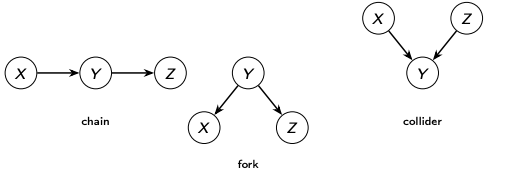

# Kernel Methods for Causal Inference

**Testing relationships between time series, benchmarking against known ground truth, and exploring applications in quantitative finance.**

Two time series can move together without one causing the other. This project investigates statistical tools used in causal discovery: methods that test whether entire time series are independent, including when conditioning on another process.

Built on my bachelor's thesis in physics, it brings together stochastic simulation, kernel methods, statistical testing, and machine learning. I am turning the research code into a documented Python project, with financial time series as a planned application.

## Why look beyond correlation?

Pearson correlation measures **linear association**. It can miss a strong nonlinear relationship: if `X` is a standard normal variable and `Y = X²`, their population correlation is zero, even though knowing `X` determines `Y` exactly. Zero correlation therefore does not imply independence.

Even when correlation detects a relationship, it cannot establish its causal direction. The diagram below shows three ways variables can be connected:



- **Chain:** `X → Y → Z`. An influence travels through an intermediate variable.
- **Fork:** `X ← Y → Z`. A shared cause can make `X` and `Z` associated without either causing the other.
- **Collider:** `X → Y ← Z`. Two causes share an outcome; conditioning on that outcome can create an association between otherwise independent causes.

Under the usual causal graph assumptions, conditioning on `Y` blocks the path between `X` and `Z` in a chain or fork, but opens it in a collider. This is why testing **conditional independence** matters: it helps distinguish structures that pairwise association alone cannot resolve.

Kernel methods allow independence tests to capture nonlinear dependencies beyond Pearson correlation. This project applies them to whole time-series trajectories, providing evidence for causal discovery under explicit assumptions.

## What the project does

- **Generate controlled datasets:** simulate stochastic processes with known causal relationships, so methods can be evaluated against ground truth.
- **Compare entire trajectories:** use signature kernels to represent relationships between paths as Gram matrices.
- **Test statistical independence:** apply HSIC for unconditional independence and SDCIT for conditional independence, building blocks for causal discovery.
- **Benchmark alternative kernels:** compare a classical Gaussian (RBF) baseline with a quantum embedding kernel, including circuit optimization and experiments with 4, 6, and 8 qubits.

The thesis also included quantum computations on IBM Heron hardware. The focus here is on the complete experimental workflow: implementing methods, checking their behavior, and evaluating their limitations.

## From data to evaluation

```text
Simulated time series with known relationships
                    |
                    v
       Signature-kernel Gram matrices
                    |
                    v
   Independence and conditional independence tests
                    |
                    v
       Evaluation against known ground truth
```

Independence tests provide evidence used by causal discovery algorithms. Causal conclusions additionally depend on the algorithm's assumptions and the data-generating process.

## Engineering focus

The repository is being organized around reusable simulation, kernel, and testing components, with experiments kept separate from the core implementation. The publication process will add reproducible environments, focused checks, and documented experiment settings alongside the code.

The research implementation uses **Python, NumPy, SciPy, JAX, Diffrax, PennyLane, Optax, and sigkerax**, with SDCIT providing reference statistical tests and Qiskit supporting hardware experiments.

## Quantitative finance direction

The next application is to investigate dependencies in financial time series and assess whether they offer useful inputs to systematic trading research. This extension will require evaluation on held-out data, attention to temporal leakage, and realistic trading costs.

Financial experiments are planned; this repository does not yet demonstrate a trading advantage. The quantum experiments likewise investigate performance relative to a classical baseline without assuming quantum superiority.

## Repository status

**Incremental publication in progress.** This repository currently contains the project overview. Research code and results will be added in small, reviewable steps:

1. Environment setup and stochastic-process simulation.
2. Classical signature kernels and statistical independence tests.
3. Quantum-kernel implementation and optimization.
4. Benchmark experiments, results, and reproduction instructions.
5. Financial time-series experiments.

Setup and execution instructions will accompany the relevant code.

## Research background

The thesis builds on *Signature Kernel Conditional Independence Tests in Causal Discovery for Stochastic Processes* by Manten et al. (ICLR 2025). Its main extension explores replacing the classical static kernel within the signature kernel with a trainable quantum embedding kernel.
